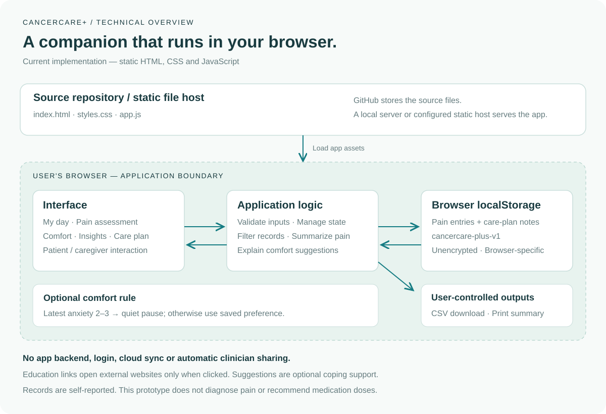

# CancerCare+

A research-informed web prototype that turns cancer pain experiences into structured records, explainable comfort suggestions, and summaries for care-team conversations.

**Project origin:** Julaluck Tantipaswasin’s Medical Technology research at Mahidol University. **Current implementation:** a browser-local web adaptation created with OpenAI Codex assistance. **Status:** functional prototype, not clinically validated.

## Reviewer guide

Start with the [UI gallery](docs/UI.md) and [architecture](docs/ARCHITECTURE.md). To try the app, download the repository and open `index.html`; no installation, API keys or build step is required.

| What this project demonstrates | Where to look |
| --- | --- |
| Translating a healthcare research problem into a usable product | Research foundation and the six-part assessment |
| Explainable personalization | `recommendation()` in `app.js`; the comfort screen explains its rule |
| Practical privacy boundaries | Browser-local storage and explicit exports; no automatic clinician sharing |
| Responsible use of AI development tools | Codex-assisted implementation with documented tests and limitations |

### Problem and approach

Patients and caregivers need a consistent way to describe pain episodes between appointments. CancerCare+ combines structured self-reporting, optional coping activities, and a diary with follow-up scores. It aims to support communication; it does not infer a diagnosis or prescribe treatment.

### AI use and project provenance

The supplied academic research establishes the problem and the original application concept. This web adaptation was developed with OpenAI Codex assistance for implementation, documentation and verification. The app itself does **not** call an OpenAI API or use a language model: its personalization is a deterministic rule. No model-performance results or clinical outcomes are claimed.

### Next development steps

- Conduct clinician review and patient/caregiver usability testing.
- Reassess storage, consent and authentication before collecting real patient data.
- Add a reviewed automated browser test suite and accessibility audit.
- Evaluate any future AI-assisted summary feature separately, using synthetic data first, explicit consent, grounded outputs and clinician review. This is a proposal, not an implemented feature.

## UI preview and architecture

Explore the app without running it:

- [UI gallery: overview, assessment, comfort activities and insights](docs/UI.md)
- [Architecture and data flow](docs/ARCHITECTURE.md)
- [Sea x OpenAI: project context and proposed AI direction](docs/HACKATHON.md)

### App overview

Screenshots show an empty app; no real patient records are included.

### Current architecture

## Run and publish
Open index.html in a modern browser, or serve this folder with a static HTTP server. For GitHub Pages, upload these files at the repository root, then choose Settings > Pages > Deploy from a branch > main > / (root) > Save. The app works under a repository subpath.

## Research foundation
Adapted from the user-provided thesis **Designing a Mobile Application for Breakthrough Cancer Pain Assessment and Personalized Pain Relief**, Julaluck Tantipaswasin, Faculty of Medical Technology, Mahidol University, academic year 2566; advisor Dr. Nutta Homdee, and the accompanying presentation dated December 12, 2023.

Source documents informed these requirements:
- Thesis PDF p. 15 (printed p. 4): intensity, location, character, duration, triggers, daily life and medication timing.
- Thesis PDF pp. 24, 33–39: patient/caregiver audience, assessment, personalized suggestions and visual summaries.
- Thesis PDF p. 37 (printed p. 26): anxiety-to-meditation example.
- Thesis PDF pp. 40–41: limitations and need for clinician review and usability evaluation.
- Presentation pp. 11, 33–36: assessment parameters, medication records and core feature set.

The implementation is independently authored. No source PDFs, research screenshots, student identifiers, signatures, or original research assets are included in this repository. App screenshots in docs/images are generated from this web implementation. This is not the original FlutterFlow code, an endorsement by the university, or a clinically validated reproduction.

## Implemented
Six assessment areas: intensity/timing; location/character; pattern/triggers; medication record; symptoms/daily life; comfort activity/notes. Includes patient/caregiver attribution, event timestamps, follow-up scores, diary filtering, per-event plot, seven-day summary, CSV export, print visit summary, care-plan notes, optional timed comfort exercises, and explicit local-data deletion.

### Transparent personalization
The latest record with anxiety value 2 or 3 highlights quiet breathing. Otherwise a user-selected preference is highlighted, or all activities have equal priority. Thresholds are implementation choices, not a validated research algorithm. The research's full intervention dataset and clinical decision rules were not available as machine-readable resources. Suggestions are optional coping support; no treatment efficacy or causal effect is inferred from follow-up scores.

### Deliberate scope
No diagnostic classification, medication recommendations, dose calculations, authentication, cloud database, provider portal, notifications, emergency monitoring, or automated clinical alerts. Unlike the research prototype's Firebase/authentication architecture, this version is a static, browser-local prototype. A real clinical deployment requires separate clinical, security, accessibility, usability and privacy review.

## Clinical education checked October 21, 2026
- NCI, Pain and Cancer Treatment: https://www.cancer.gov/about-cancer/treatment/side-effects/pain
- NCI, Meditation and Relaxation: https://www.cancer.gov/about-cancer/coping/feelings/relaxation
- American Cancer Society, Non-medical Ways to Manage Pain: https://www.cancer.org/cancer/side-effects/pain/cancer-pain/non-medical-treatments-for-cancer-pain.html

Optional comfort activities complement the prescribed plan. New/different or severe reported pain shows care-team contact guidance, not a clinical triage result. No local emergency number is guessed.

## Data and security
Entries and the plan are stored as unencrypted JSON in localStorage under cancercare-plus-v1, scoped to this browser profile and origin. People using the same profile can access records. There is no transmission, login, cloud sync or automatic backup. External education links navigate to third-party services only when clicked. Clearing site data removes records; export before changing devices. No sample patient records ship with the app. Do not commit diary exports or real patient information.

Free-text output is HTML-escaped. CSV cells are quoted and formula-leading content is neutralized. Storage failures retain the form; unreadable prior data is not silently overwritten. Event dates in the future are rejected. The chart shows only recorded observations, without interpolation across missing time.

## Files
index.html — accessible screens and dialogs
styles.css — responsive styling, reduced-motion and print support
app.js — persistence, summaries, personalization and interactions

## Verification
JavaScript syntax and targeted logic checks cover filtering, averages, personalization, HTML escaping, CSV serialization and storage failure handling. Browser checks confirmed assessment saving, anxiety-based highlighting, follow-up persistence after reload, and desktop/mobile layouts. CSV serialization was checked in code; the browser download check timed out and remains unverified end to end. Not clinically validated.