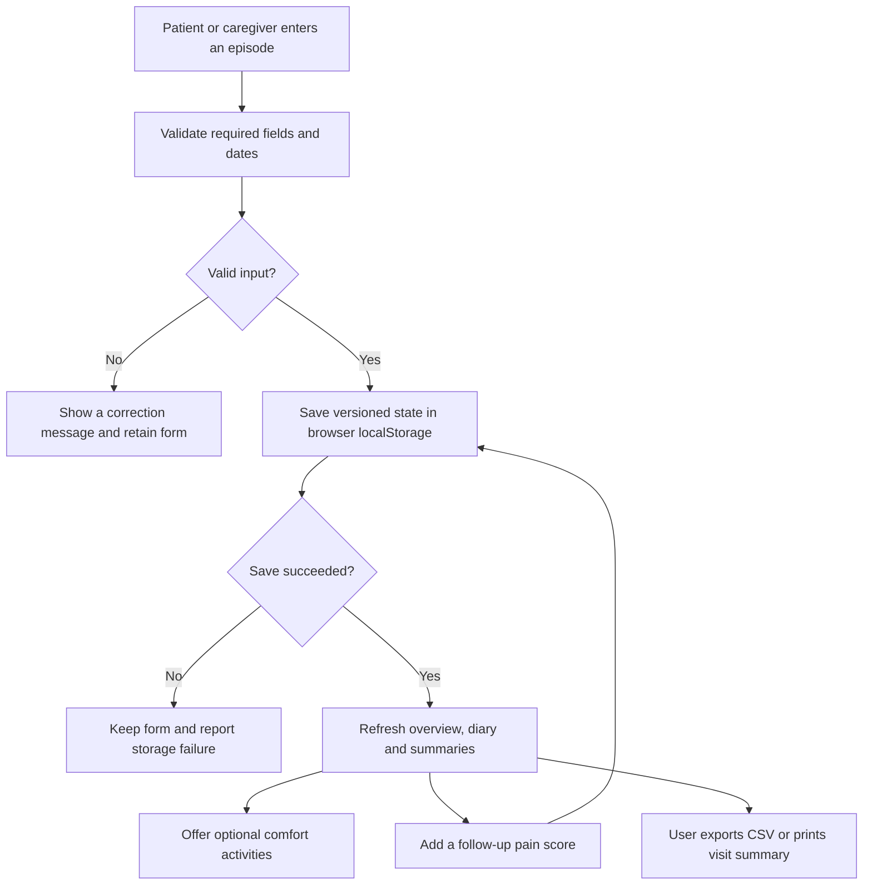

# Architecture

## Scope

This describes the current static web implementation, not the original research project's Firebase architecture. Hosting on GitHub Pages requires its separate Pages configuration.

## Components

| Component | Responsibility |
| --- | --- |
| `index.html` | App screens, assessment form, care-plan form, dialogs and navigation |
| `styles.css` | Responsive layout, accessible focus behavior, reduced-motion and print rules |
| `app.js` | Validation, navigation, state, persistence, personalization, summaries and exports |
| Browser `localStorage` | Stores versioned pain entries and care-plan notes under `cancercare-plus-v1` |
| CSV / browser print | User-controlled files and visit summaries; no automatic upload |
| External education pages | Open only when the user follows a link; not part of the application backend |

## Record lifecycle

## Personalization

The latest episode with anxiety value 2 or 3 highlights quiet breathing. Otherwise, the user's saved comfort preference is highlighted. Without either, no activity is prioritized. All activities remain available. This is a simple explainable rule, not a diagnostic or validated clinical decision algorithm.

## Data boundary

There is no application server, authentication, provider portal, cloud database, monitoring, or automatic care-team transmission. Source files can be public without publishing a user's browser records. Records remain unencrypted in the same browser profile and origin; clearing site data removes them. Exported files and printouts contain whatever information the user entered and must be handled separately.

## Source mapping

See [the main README](../README.md#research-foundation) for research references and differences from the original prototype.