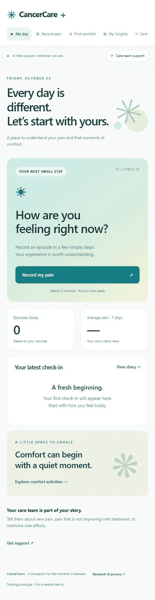
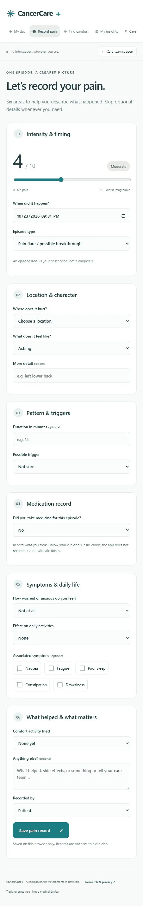
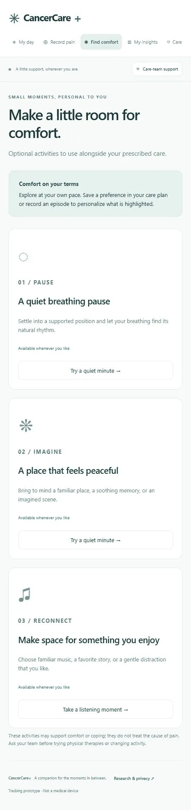
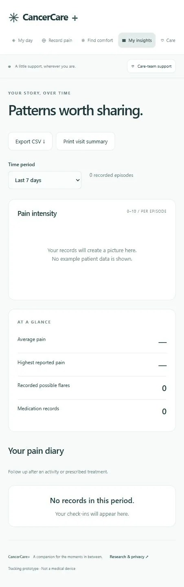
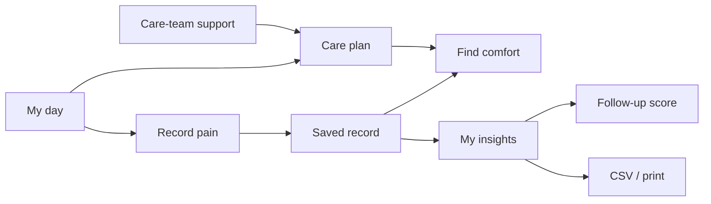

# UI preview

Actual screenshots of the current web application, captured October 23, 2026. The app is shown with no saved patient records. The assessment's pain slider is its default form value, not a patient observation. Screenshots show one responsive viewport; layouts adapt to screen size.

## My day

The overview provides entry points to recording pain, the latest record, seven-day average and comfort activities.

## Record pain

Six assessment groups cover intensity and timing, location and character, pattern and triggers, medication records, symptoms and daily life, and comfort activities and notes.

## Find comfort

Optional breathing, imagery and music/distraction activities. The reason for highlighting an activity appears above the cards when the user's records or preferences apply.

## My insights

The empty diary is shown intentionally. With records, this screen displays individual pain observations, period summaries, follow-up scores and export controls.

## Screen map

## Refreshing screenshots

Serve the repository root on a local HTTP server, open it with a clean browser profile, and capture the `#home`, `#record`, `#comfort`, and `#insights` screens. Replace the corresponding WebP images in `docs/images/`. Never publish screenshots containing real patient information.